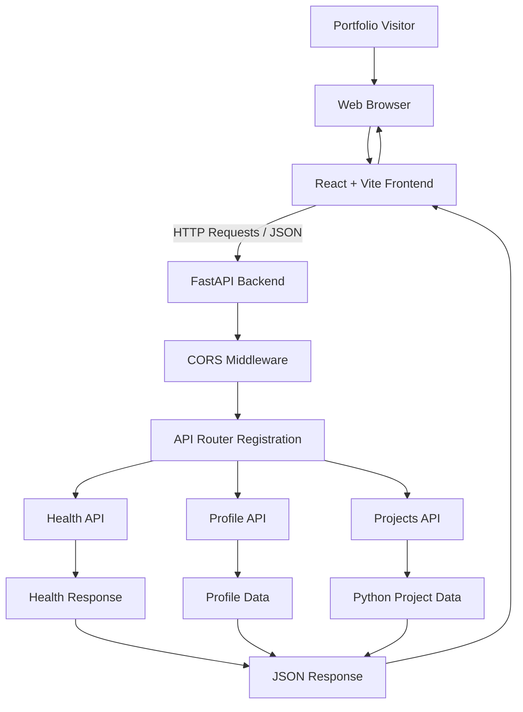

# Current Application Architecture

## 1. Overview

The Kanishka Portfolio is a web application consisting of a React frontend and a Python FastAPI backend.

The frontend retrieves portfolio profile and project information through REST API endpoints.

## 2. Technology Stack

| Layer | Technology |
|---|---|
| Frontend | React, Vite, JavaScript |
| Backend | Python, FastAPI |
| ASGI Server | Uvicorn |
| API Communication | HTTP / JSON |
| Validation | Pydantic |
| Testing | Pytest |

## 3. Request Flow

1. A visitor opens the portfolio in a browser.
2. React renders the portfolio interface.
3. The frontend requests profile and project information from FastAPI.
4. FastAPI routes requests to the appropriate API module.
5. The backend returns JSON responses.
6. React displays the returned information.

## 4. Backend API Modules

| Module | Responsibility |
|---|---|
| health.py | Health-check endpoint |
| profile.py | Portfolio profile information |
| projects.py | Project listing and individual project details |
| main.py | Application initialization, CORS and router registration |

## 5. API Endpoints

| Method | Endpoint | Purpose |
|---|---|---|
| GET | / | API welcome response |
| GET | /profile/ | Retrieve profile information |
| GET | /projects/ | Retrieve all projects |
| GET | /projects/{project_id} | Retrieve an individual project |

Unknown project IDs return HTTP 404.

## 6. Current Data Storage

Profile and project information is currently maintained as Python data structures in the backend source code.

A database has not yet been integrated.

## 7. Current Limitations

- No database integration.
- No authentication or authorization.
- No AI integration.
- No containerized deployment.
- No automated CI/CD pipeline.
- No Kubernetes deployment.
- No production monitoring configuration.

## 8. Planned Improvements

- Docker containerization.
- GitHub Actions CI/CD.
- AWS infrastructure provisioning.
- Kubernetes deployment.
- Prometheus and Grafana monitoring.
- AI-powered portfolio assistant
These improvements will be documented as implemented only after successful verification..

## 9. Architecture Diagram

